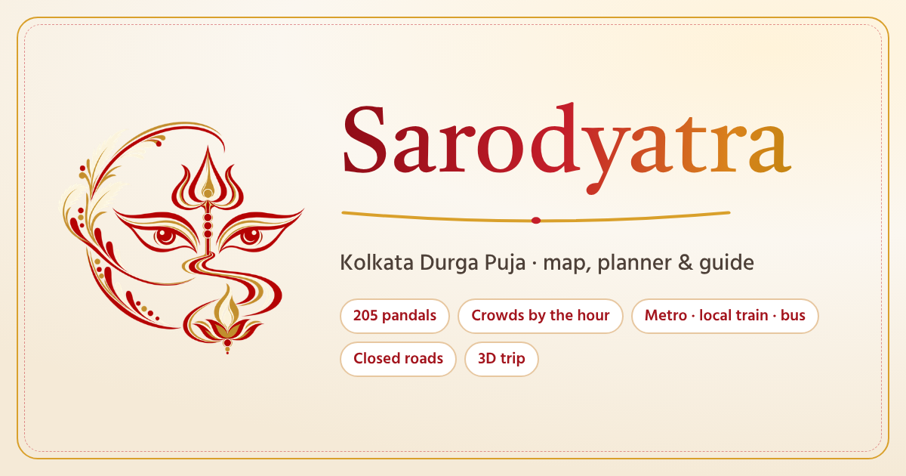

<p align="center"></p>

# Sarodyatra — Kolkata Durga Puja WebGIS

A GeoServer + Leaflet WebGIS for Durga Puja 2026 that plans a whole Puja night door to door:
**205 pandals (famous, bonedi bari and local), crowds hour by hour, 5 metro lines, 355 local-train stations with real
timetables, 603 bus routes, 86 000 road segments, Puja road closures, a 3D trip with a voice guide and "Sarathi", a multilingual assistant that can talk.**
The whole interface switches between **English · বাংলা · हिंदी** (top-right).

Course stack: **GeoServer · WMS · WFS · WFS-T · WCS · GML · SLD (XML) · Leaflet · HTML · CSS · JavaScript**
(+ FastAPI, MapLibre GL for 3D).

---

## 1 · Run it (Windows)

You need **Python 3.10+** and the **GeoServer** you installed in class.

1. **Start GeoServer** and check http://localhost:8080/geoserver opens.
2. **Publish the layers** (first time and after an update): double-click `setup_geoserver.bat`. It creates workspace `pujox`
   and uploads 10 shapefiles + 1 GeoTIFF with 11 SLD styles. If your GeoServer login is not `admin / geoserver`, edit `backend\.env` first.
3. **Start Sarodyatra**: double-click `run.bat` — or in a VS Code terminal:

```bat
.venv\Scripts\activate
set PYTHONUTF8=1
cd backend
python -m uvicorn main:app --reload --port 8000
```

Open **http://localhost:8000**. The status chip shows **Live** when GeoServer answers, otherwise **Local data**
(the app still works from the same files).

**Sarathi with full AI (optional):** put free Gemini keys in `backend\.env` → `GEMINI_API_KEYS=key1,key2` and restart.
Keys stay on the server; the browser never sees them. Without keys Sarathi uses its built-in offline brain (English, বাংলা, Banglish, हिंदी). With keys, anything the offline brain understands for sure (outings, routes, trains, food, help) is still answered instantly; the AI takes the open questions.

**Voices:** the 3D trip guide and Sarathi speak in the website's language (English · বাংলা · हिंदी). Microsoft Edge already has natural Bengali, Hindi and Indian-English voices; in other browsers the server speaks with neural voices (`edge-tts`, installed by `run.bat` / `pip install -r backend\requirements.txt`, needs the internet once per sentence — every sentence is cached in `data/cache/tts`).

**Code:** https://github.com/priyanshusaha0404/SARODYATRA · **Put it online:** see [DEPLOY.md](DEPLOY.md) (GitHub + Render, free; `render.yaml` is ready).

---

## 2 · What it does

| Part | What it does |
|---|---|
| **Start** | Your GPS position, or whatever you type — a home area, a railway or metro station, or any pandal name. The map centre is never used; if neither is known the app asks. |
| **Plan (left)** | *Getting there* (decide for me / local train / by road), *Travel* in the city (smart / walk / metro / taxi), *Leave at*, *Time I have* (no limit or 1–6 h), best order, train back home. Planned rows show every hop: the local train with number and times, the station to get off, metro line, walk, bus number or toto — and for long walks a **walk ↔ bus** choice. |
| **Door-to-door journey** | From a home outside the city (e.g. Madhyamgram, Barasat, Sonarpur): the next suitable train, the best station to get off (Sealdah, Bidhannagar Road, Dum Dum… whichever reaches the pandals soonest), every pandal of the chosen area timed against its crowd, and the last train home. With a time limit only the most worthwhile pandals are kept and you are home in time; without one it plans until late night — never past the last train. Famous 100 · bonedi 50 · local 15 weights when you don't say. |
| **Map** | OSM or Satellite. Layer chips: Pandals · Metro · Local trains · Roads · Closures. Blocked roads are drawn as black-and-yellow **hazard tape** (red core when closed to everyone) so they read on both base maps; roads that are blocked on other Puja evenings but not at the selected time show as a dotted yellow line. Clicking a pandal zooms in and shows a bigger pulsing pin. |
| **Cards (right)** | Pandal: name in 3 languages, photos, crowd (**Live** from visitor reports or a weather-adjusted estimate), best visit window, nearest metro, route. Metro station: timetable incl. Puja specials. Railway station: next trains with numbers, last train from Sealdah/Howrah, "Start my trip from here". |
| **Sarathi** | Floating button with Maa Durga's three eyes. Holds a conversation: *"north jabo"* → asks where you live or are now → *"Madhyamgram e thaki"* → asks local train or road → plans it all and draws it → asks walk or bus for the long hops. Understands *"2 ghonta"*, *"shudhu famous"*, *"bonedi o"*, *"5 tay beriye"* as changes to the plan, *"sealdah theke hatibagan"* as a route (asks where you start if it doesn't know), and misspelt names (*"hatibagn"*, *"baghbazaar"*, *"behela"*). **Voice**: the speaker button in its header makes it read its answers aloud (on/off, remembered); the mic button lets you speak. Also crowds, metro/train times, food, toilets, hospitals, reports. |
| **Start trip (3D)** | 3D city with buildings; pandals stand as **3D push-pins**; every leg drawn by mode; a traveller moves with a follow camera. **Voice guide** (on/off button): says where you are heading, the platform-side steps at every metro station (line, direction, where to get off) and railway station (train number, time), and on reaching a pandal its name, type, crowd and queue — in English, বাংলা or हिंदी (Microsoft Edge has Bengali and Hindi voices). **Pause anywhere**: a 500 m circle pulses around you with restaurants, sweets, toilets, water, ATMs, pharmacies, hospitals, police, pandals, metro/rail stations and bus stops pinned inside it — tap one for its name and type, **Go** draws the walk there, search the list, **Resume** continues the trip from that point. |
| **Export** | A full **plan report** (PDF / Word): key numbers, a real map of the whole outing and of the city part, a timeline chart, where the time goes, queue at each pandal, the city crowd curve with your visits, a step-by-step table with every train, metro, walk, bus and toto, both trains, notes and emergency numbers. Also GPX, GeoJSON, Google Maps, share link, save. |

**Getting in:** a local train first when one is near (Sealdah, Dum Dum and Bidhannagar Road are the main hubs), then the metro in the city (metro beats a taxi unless it is much slower; toto/auto to and from the metro when the station is a long walk; a bus before a taxi), and the way home goes by metro to a station like Dum Dum or Sealdah unless a taxi gets you home clearly earlier. Road only when there is no train or metro — or when you choose *by road*.

Works offline once used: tiles, photos, fonts, POIs and translations are cached in `data/cache/` by the server.

---

## 3 · OGC services (for the report / viva)

| Service / operation | Where |
|---|---|
| WMS GetMap | roads (CQL by class), metro lines, **local-train lines (CQL by corridor)**, bus corridors, puja zones, crowd raster, pandals |
| WMS GetFeatureInfo / GetLegendGraphic | road popups, crowd value on the raster · legends in the Data panel |
| WFS GetFeature (GeoJSON / GML2 / GML3 / SHAPE-ZIP / CSV) | interactive layers · Data panel downloads |
| **WFS-T** Transaction Insert | visitor reports, one-tap crowd reports, drawn closures (`backend/geoserver.py`) |
| WCS GetCoverage | crowd-pressure GeoTIFF for the current view |
| SLD (XML) | 11 styles in `geoserver/styles/` (rule-based, scale-dependent, raster colour map, hazard-tape closures) |
| REST API | `scripts/setup_geoserver.py` publishes everything |

Architecture: **Browser (HTML/CSS/JS + Leaflet, MapLibre for 3D)** ⇄ **FastAPI** (closure-aware routing, journey planner, Connection-Scan
train search, bus options, AI proxy, reverse proxy to GeoServer) ⇄ **GeoServer** (WMS/WFS/WFS-T/WCS) ⇄ **data** (shapefiles + GeoTIFF + JSON).

---

## 4 · Folder map

```
pujox/
├── run.bat · setup_geoserver.bat · run.sh · render.yaml · DEPLOY.md
├── backend/   main.py (API) · journey.py (door-to-door planner) · rail.py (train timetable, Connection Scan) · bus.py
│              routing.py · metro.py · crowd.py · tiles.py (offline cache) · geoserver.py · store.py · .env.example
├── frontend/  index.html · css/style.css · js/*.js (i18n.js = all UI text in 3 languages) · vendor/ · assets/ (logo, icons)
├── geoserver/ styles/*.sld · upload/*.zip
├── data/      pandals · metro · rail_* · bus_network · roads index · routing graph · closures · zones · crowd GeoTIFF · calendar
└── scripts/   setup_geoserver.py · build_transit.py · build_all.py (+ build_pandals / build_metro / build_network)
```

## 5 · During Puja

- **Puja special metro timings** — `data/metro_timings.json`. **Puja dates** — `data/puja_calendar.json`.
- **Official road closures** — draw them in the Data panel (organiser tools) or add to `data/closures.geojson`.
- **Puja special local trains** are not in the timetable — the station card says so; check NTES before leaving.
- **UI text** — `frontend/js/i18n.js` (`key: [English, বাংলা, हिंदी]`).

## 6 · Notes

- **Logo** (`frontend/assets/logo.png`): Maa Durga's eyes under the trishul, with kash flowers and a lotus lamp, in sindoor red and gold. Name, logo and Sarathi stay in English in every language.

- Crowd levels are **Live** only where visitors reported in the last 90 minutes; elsewhere they are an estimate (labelled).
- Bus ride times are estimates (distance and an average wait), not a timetable; buses only run on main roads.
- Restaurants and help points come from OpenStreetMap and need the internet once per area.

Data credits: [data/SOURCES.md](data/SOURCES.md) — including OpenStreetMap contributors (ODbL) and the
[Calcutta Transport](https://github.com/arkodeepg/calcutta-transport) open feed (ODbL) for local trains and bus routes.
